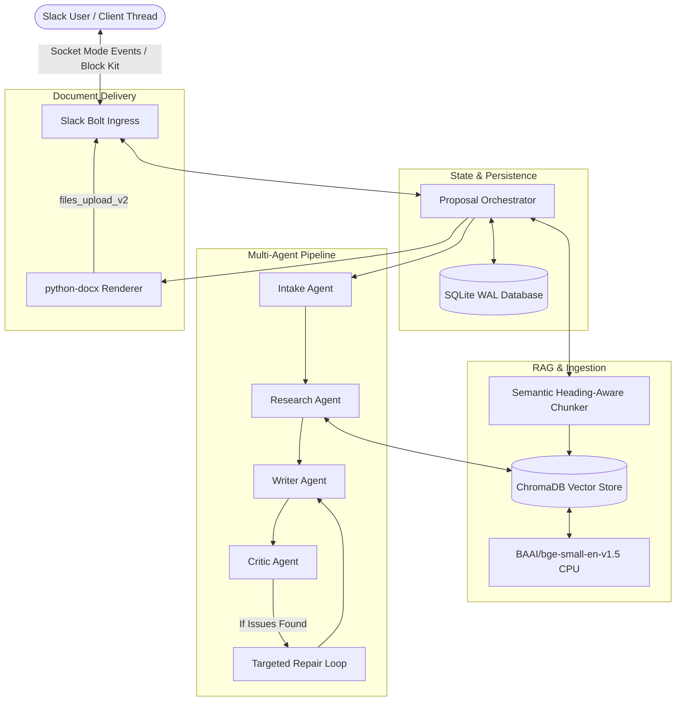

# Slack-Based Multi-Agent Proposal Assistant

A production-grade, grounded multi-agent AI system running inside **Slack** via **Socket Mode**. It transforms raw, unstructured client discovery call transcripts into tailored, highly structured Microsoft Word (`.docx`) management consulting proposals with strict factual provenance and human-in-the-loop review.

---

## Key Capabilities

- **Strict Factual Provenance & Anti-Hallucination:** Every number, timeline, budget figure, and metric carries a verified inline citation:
  - `(from transcript)` for facts grounded in discovery calls.
  - `(indicative, based on similar engagements — proposal_<industry>)` for benchmarked estimates derived from historical proposals.
  - Visible placeholders (e.g. `(Timeline: not confirmed on the call — to be agreed)`) for missing scoping parameters.
- **Multi-Agent Roster with Adversarial Verification:**
  - **Intake Agent:** Extracts structured client profiles with verbatim quotes, confidence ratings, missing fields, and ambiguities.
  - **Research Agent:** Queries a ChromaDB vector store across 10 historical proposal files and the runtime transcript using a 4-tier fallback ladder.
  - **Writer Agent:** Assembles consulting proposals across 6 standard sections adhering strictly to profile facts.
  - **Critic Agent & Repair Loop:** Adheres to adversarial review rules, rejecting hallucinated claims and triggering automated targeted repairs.
- **Slack Socket Mode & Block Kit UI:**
  - Interactive discovery summary cards and draft review cards.
  - Human approval gate with interactive buttons: **"Approve & Generate DOCX"**, **"Regenerate Section"**, and **"Request Changes"**.
  - Modal workflows for section-scoped regeneration without modifying surrounding text.
  - Direct file delivery via `files_upload_v2` into the Slack thread.
- **Robust Persistence & Session Resumption:**
  - SQLite with WAL mode (`PRAGMA journal_mode=WAL`) managed via SQLAlchemy 2.0.
  - Composite session keys `(channel_id, thread_ts, user_id)` allowing uninterrupted session resumption across restarts or multi-day intervals.
- **Local CPU Embeddings & Offline Testing:**
  - Uses `BAAI/bge-small-en-v1.5` for local CPU embedding and Chroma cosine retrieval.
  - Built-in `LLM_MODE=mock` fixture mode enables 100% offline testing, CI/CD execution, and smoke testing without burning API quotas.

---

## System Architecture



---

## Repository Structure

```text
Slack-based-AI-assistant/
├── app/
│   ├── agents/             # Intake, Research, Writer, Critic, and Repair agents
│   ├── db/                 # SQLAlchemy models, migrations, and repository layer
│   ├── docx/               # python-docx proposal renderer and executive styles
│   ├── llm/                # Routing, Groq/OpenRouter client, backoff, and schemas
│   ├── orchestrator/       # Pipeline coordination, state machine, and bounds
│   ├── prompts/            # Externalized agent prompts (Markdown)
│   ├── rag/                # Chunker, Chroma store, local embeddings, retrieval
│   ├── slack/              # Bolt handlers, Block Kit UI cards, modals, file upload
│   ├── config.py           # Pydantic Settings configuration
│   ├── errors.py           # Domain exceptions
│   ├── logging.py          # Structlog structured logger
│   └── main.py             # FastAPI server entry point and Bolt runner
├── data/
│   └── proposals/          # 10 historical proposal files (.txt)
├── docs/
│   ├── ARCHITECTURE.md     # In-depth system architecture & Mermaid diagrams
│   ├── EVAL.md             # Self-evaluation rubric and verification audit
│   ├── INJECTION_AUDIT.md  # Corpus security audit and runtime defense specs
│   ├── RETRIEVAL_EVAL.md   # Retrieval benchmark report (100% Recall@5, 1.0 MRR)
│   └── SLACK_SETUP.md      # Step-by-step Slack app configuration guide
├── scripts/
│   ├── eval_retrieval.py   # RAG retrieval evaluation benchmark
│   ├── ingest.py           # Standalone proposal ingestion CLI
│   ├── smoke.py            # End-to-end headless smoke test
│   └── smoke.sh            # Shell wrapper for smoke test
├── tests/
│   ├── fixtures/           # Offline LLM response fixtures and mock data
│   ├── integration/        # Full end-to-end Slack pipeline tests
│   └── unit/               # Persistence, chunker, docx, and agent unit tests
├── .env.example            # Environment variable template
├── .gitignore              # Ignores .env, *.db, chroma_db/, out/, caches
├── pyproject.toml          # Poetry / Pip dependencies and tool configurations
├── README.md               # Project documentation
└── STATUS.md               # Execution status checkpoints and milestones
```

---

## Getting Started

### 1. Prerequisites
- Python 3.11+
- Git

### 2. Installation
Clone the repository and install dependencies:
```bash
git clone https://github.com/IBRAHIMHAMID678/Slack-based-AI-assistant.git
cd Slack-based-AI-assistant
pip install -r requirements.txt  # Or pip install -e .
```

### 3. Environment Configuration
Copy the template and configure your environment variables:
```bash
cp .env.example .env
```

| Variable | Description | Default / Example |
| :--- | :--- | :--- |
| `SLACK_BOT_TOKEN` | Bot User OAuth Token | `xoxb-...` |
| `SLACK_APP_TOKEN` | App-Level Token for Socket Mode | `xapp-...` |
| `SLACK_SIGNING_SECRET` | Slack App Signing Secret | `a23808...` |
| `GROQ_API_KEY` | Primary LLM provider key | `gsk_...` |
| `OPENROUTER_API_KEY` | Secondary fallback LLM key | `sk-or-...` |
| `LLM_MODE` | Runtime mode (`mock` or `live`) | `mock` |
| `DATABASE_URL` | SQLite connection URL | `sqlite:///./proposals.db` |
| `CHROMA_PERSIST_DIR` | Chroma storage directory | `./chroma_db` |
| `EMBEDDING_MODEL_NAME` | HuggingFace embedding model | `BAAI/bge-small-en-v1.5` |

### 4. Running the Bot
Launch the server in Socket Mode:
```bash
python -m uvicorn app.main:app --host 0.0.0.0 --port 8000
```
On startup, the system will:
1. Initialize the SQLite database schema in WAL mode.
2. Ingest all 10 historical proposal files with SHA-256 idempotency.
3. Establish a Socket Mode listener with your Slack workspace.
4. Expose `GET /health` on port 8000.

---

## Verification & Quality Assurance

### Run Unit and Integration Tests
```bash
pytest -q
# Output: 43 passed in ~32s (100% pass rate)
```

### Static Analysis & Linting
```bash
ruff check .
ruff format --check .
mypy app
# Output: Success: no issues found in 36 source files
```

### RAG Retrieval Evaluation
```bash
python scripts/eval_retrieval.py
# Benchmark Results:
# Recall@5: 100.0% (10/10)
# Mean Reciprocal Rank (MRR): 1.0000 (all queries ranked at #1)
```

### Headless End-to-End Smoke Test
Run an offline end-to-end execution without needing Slack:
```bash
python scripts/smoke.py
# Generates a fully formatted 40KB DOCX proposal in out/
```

---

## Slack Workflow

1. **Upload Transcript:** Upload `client_transcript.txt` into any channel or DM where the bot is invited.
2. **Review Extracted Profile:** The bot posts a Block Kit **Client Profile Card** outlining goals, constraints, missing fields, and detected ambiguities.
3. **Review Proposal Draft:** The bot posts an interactive **Draft Review Card** with critic validation status and included sections.
4. **Approve & Download:** Click **"✅ Approve & Generate DOCX"** (or type `"approve"` in thread) to deliver the generated document.
5. **Revise Sections:** Click **"✏️ Regenerate Section"** to open a modal and rewrite any individual section while keeping surrounding sections byte-identical.

---

## Security & Defense-in-Depth

The static corpus was verified clean in [`docs/INJECTION_AUDIT.md`](file:///docs/INJECTION_AUDIT.md). At runtime, all external content is treated as untrusted:
- Data boundaries: `<<<BEGIN_UNTRUSTED_DOC>>> ... <<<END_UNTRUSTED_DOC>>>`
- Control and zero-width characters stripped at ingestion.
- Hard token length bounds with `[TRUNCATED]` markers.
- System directives isolated in system prompts only.

---

## License

MIT License. Designed and built for high-reliability management consulting workflows.

