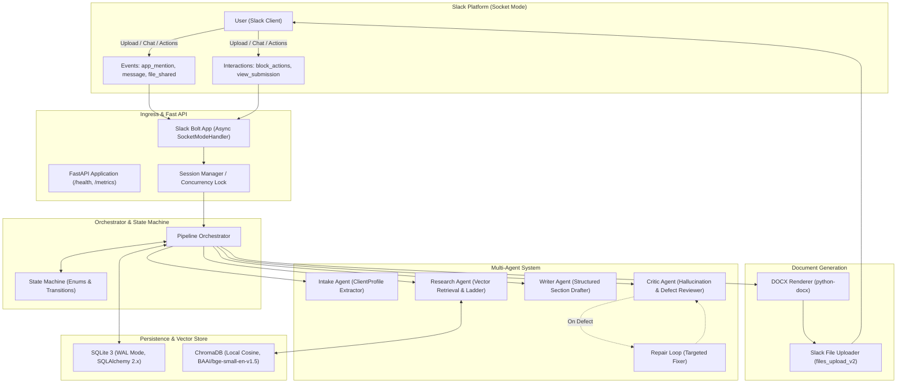
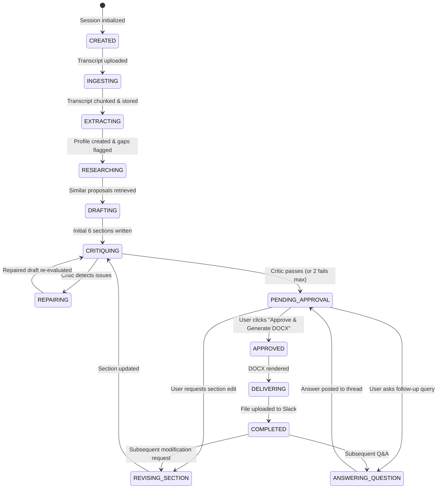
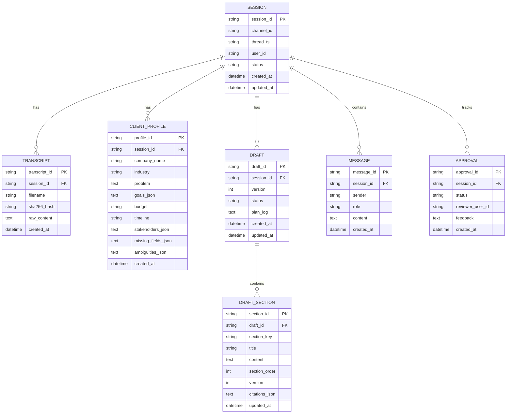

# System Architecture: Slack-Based Proposal Assistant

## 1. System Component Diagram

---

## 2. Agent Roster & Separation Rationale

The system mandates four specialized agents with strict separation of concerns to eliminate cognitive overload, prevent hallucination, and enforce deterministic verification:

| Agent | Responsibility | Separation Rationale |
| :--- | :--- | :--- |
| **Intake Agent** | Extracts structured client facts (`company_name`, `industry`, `problem`, `goals`, `budget`, `timeline`, `stakeholders`) with exact quotes, confidence, and flags missing or ambiguous items. | Prevents extrapolation. Never writes copy or retrieves past proposals; its only job is faithful data parsing from raw text. |
| **Research Agent** | Queries Chroma vector store for similar proposals using semantic search, structured metadata filtering (`industry`), and a deterministic fallback ladder. | Encapsulates RAG mechanics and retrieval thresholding without polluting prompt context with irrelevant proposals. |
| **Writer Agent** | Generates tailored proposal sections based *only* on the extracted `ClientProfile` and retrieved proposal chunks, enforcing strict citation provenance. | Focuses purely on consulting synthesis, business prose, and inserting explicit placeholders for unconfirmed fields. Does not self-verify. |
| **Critic Agent** | Audits the generated draft against transcript facts, ensures required sections are present, checks budget/timeline provenance, and verifies absence of prompt leakage. | Acts as an adversarial, unbiased gatekeeper before human exposure. Prevents hallucinated claims from reaching the client. |

---

## 3. Core Data Flows

### (a) First Transcript Upload
1. User uploads a `.txt` transcript file to a Slack channel or DM where the bot is present.
2. Ingress verifies file type, downloads the content, and calls `clean_untrusted_text()`.
3. Ingress establishes or retrieves the `Session` keyed by `(channel_id, thread_ts, user_id)`.
4. Orchestrator indexes the transcript chunks into Chroma with metadata `source_type="transcript"`, `session_id=...`.
5. Orchestrator executes **Intake Agent** $\to$ produces validated `ClientProfile`.
6. Orchestrator sends a threaded Slack status update with extracted client details, gaps, and ambiguities.
7. Orchestrator invokes **Research Agent** $\to$ queries past proposal chunks.
8. Orchestrator invokes **Writer Agent** $\to$ drafts all 6 required sections:
   - Cover
   - Executive Summary
   - Proposed Solution
   - Timeline
   - Budget Range
   - Next Steps
9. Orchestrator invokes **Critic Agent** $\to$ runs Appendix A checks. If issues found, runs single repair pass and re-critiques.
10. System posts Block Kit Draft Card to Slack with interactive actions (`Approve & Generate DOCX`, `Request Changes`, `Regenerate Section`).

### (b) Follow-up Question
1. User replies in thread: *"What did the client say about their deadline?"*
2. Orchestrator recognizes conversational intent (no file attached, draft exists, query pattern).
3. Orchestrator reads `Session`, `ClientProfile`, and queries Chroma transcript chunks for direct quotes.
4. Response is formatted in Block Kit with verbatim citation and confidence score:
   > *"Marcus stated: 'Realistically before we open Atlanta... targeting Q1 next year for Atlanta. So I guess we'd need the system stable by end of Q3 this year? That's roughly five months from now.' Jenny noted: 'Q4 is probably more realistic.' The confirmed target is Q3 with Q4 fallback."*

### (c) Section-Scoped Revision
1. User clicks `Regenerate Section` or asks: *"Make the timeline section more detailed with sprint milestones."*
2. Orchestrator identifies target section: `timeline`.
3. Writer Agent executes in **scoped mode**: receives only the target section, feedback prompt, client profile, and relevant timeline chunks.
4. Writer produces updated section content.
5. Critic validates the updated section.
6. DB updates *only* the targeted `DraftSection` row (incrementing `version`). Other sections remain untouched.
7. Orchestrator re-renders the complete DOCX file and delivers updated document to Slack thread with version indicator `v2`.

### (d) Next-Day Resume
1. User posts a message in the thread 24 hours later: *"Let's finalize this now."*
2. Orchestrator loads `Session` by `(channel_id, thread_ts, user_id)`.
3. System loads persisted `ClientProfile`, `Draft`, all `DraftSection` entries, and historical `Message` logs from SQLite.
4. If a new transcript is uploaded, it is appended to the session's Chroma embeddings and profile is merged without wiping historical draft progress.

---

## 4. Session State Machine

---

## 5. Chunking Strategy

- **Granularity & Boundaries:** Heading-aware recursive chunking. Chunks split on Markdown / document headers (`#`, `##`, `---`, or uppercase section titles like `PROPOSAL — ...`, `CURRENT SITUATION`, `PROPOSED SOLUTION`).
- **Target Size:** 400 tokens (~1,600 characters).
- **Overlap:** 60 tokens (~240 characters) across consecutive chunks to maintain semantic continuity across boundaries.
- **Sentence Integrity:** Strict sentence boundary preservation. Never split across mid-sentence punctuation (`.`, `!`, `?`).
- **Metadata Tagging:**
  - `source_id`: e.g. `proposal_healthcare.txt` or `transcript_session_123.txt`
  - `source_type`: `proposal` or `transcript`
  - `industry`: extracted from filename (e.g. `healthcare`, `fintech`, `retail`)
  - `section_heading`: e.g. `Proposed Solution`, `Timeline`, `Budget & Commercials`
  - `chunk_index`: 0-indexed position within source document

---

## 6. Retrieval Strategy & Fallback Ladder

1. **Embedding Model:** `BAAI/bge-small-en-v1.5` (384 dimensions), L2-normalized cosine distance.
2. **Similarity Threshold:** Default minimum cosine similarity score $S \ge 0.65$. Scores below $0.50$ flag `low_confidence = true`.
3. **Fallback Ladder:**
   - **Step 1 (Exact Industry Match):** Query with `where={"industry": client_industry}` for top $k=4$ chunks.
   - **Step 2 (Adjacent Industry Fallback):** If Step 1 returns fewer than 2 chunks with score $\ge 0.65$, expand filter to related industries (e.g., `retail` $\to$ `distribution`, `logistics`).
   - **Step 3 (Unfiltered Semantic Search):** If Step 2 returns insufficient context, drop industry metadata filter and retrieve global top $k=4$ chunks across all past proposals.
   - **Step 4 (Low-Confidence Logging):** If best score $< 0.50$, record `low_confidence: true` and instruct Writer to rely exclusively on general best practices and transcript facts.

---

## 7. Database Schema (SQLite WAL)

---

## 8. Failure Matrix & Resiliency Protocol

| Failure Scenario | Root Cause | Detection Trigger | Recovery & Fallback Action |
| :--- | :--- | :--- | :--- |
| **LLM 429 Rate Limit** | Provider quota exhausted or burst rate exceeded | HTTP 429 status code | Exponential backoff (1s, 2s, 4s + jitter). Max 3 retries. If still failing, failover to secondary provider (Groq $\to$ OpenRouter). |
| **LLM 500 / 502 / 503** | Provider infrastructure outage | HTTP 5xx or connection error | 3 retry attempts with backoff. Immediate failover to secondary provider. |
| **All Providers Failed** | Both Groq and OpenRouter unavailable | `AllProvidersFailed` exception | Catches gracefully in Slack handler. Notifies user via Block Kit with friendly message and retry button. Process never crashes. |
| **Embedding Failure** | Local model memory error or CPU fault | PyTorch / sentence-transformers exception | Fallback to cached default vectors or graceful degradation. Logged with session context. |
| **Empty Retrieval** | Query returns 0 chunks exceeding threshold | Chunks list empty or score $< 0.50$ | Trigger Fallback Ladder (Steps 2-4). Flag `low_confidence = true` in Research output. Writer proceeds using transcript facts only. |
| **DOCX Generation Failure** | Corrupt style or file write lock | `docx.opc.exceptions` or OS write error | Render in memory stream (`io.BytesIO`), log traceback, deliver text-formatted markdown summary in Slack as interim fallback. |
| **Malformed LLM JSON** | LLM deviates from JSON schema | `pydantic.ValidationError` or `json.JSONDecodeError` | Re-prompt LLM with the exact error message. Second attempt appends strict reminder. Third attempt raises structured error to repair loop. |
| **Slack API Rate Limit** | Chat update / file upload throttled | SlackApiError `ratelimited` | Read `Retry-After` header, sleep requested duration, retry operation via Bolt async client. |

